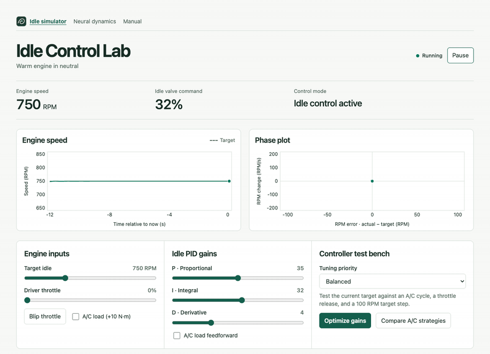
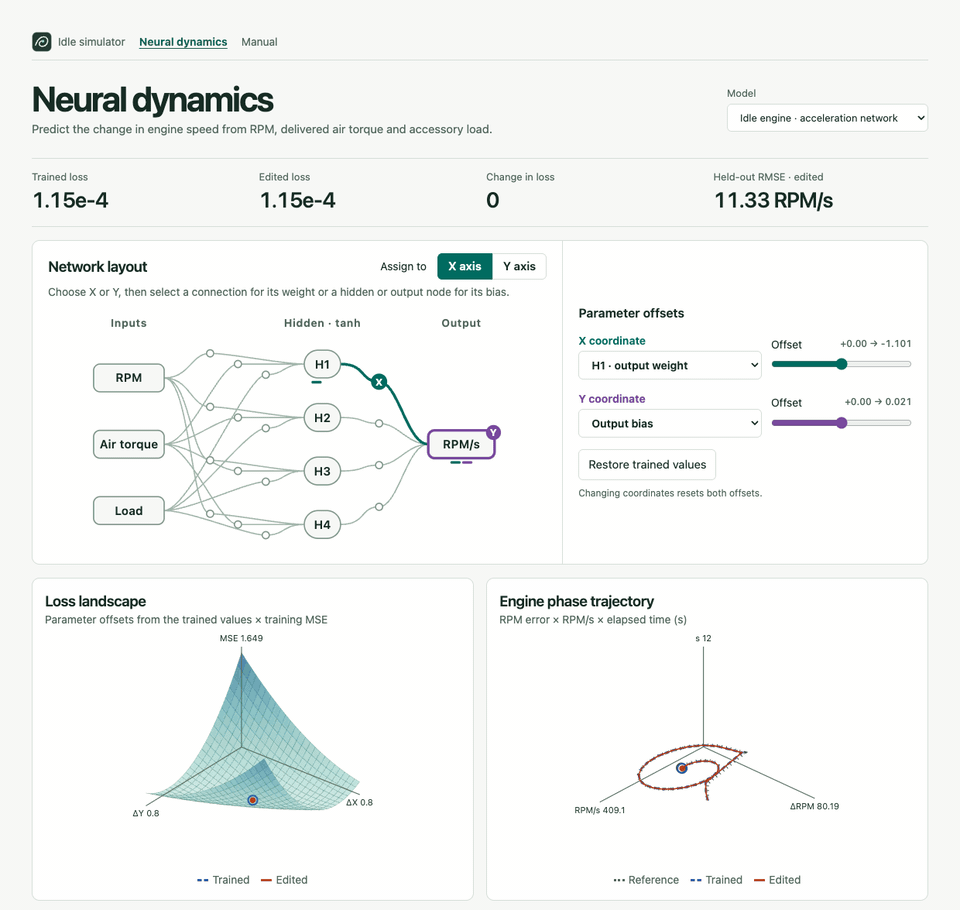

# Idle Control Lab

Adjust the throttle and PID gains in the idle simulator, or change a network weight in the neural lab to see how its loss and motion change. Both run in your browser.

**[Launch the idle simulator](https://openmotorsportproject.github.io/idle-control-lab/)** · [Open the neural lab](https://openmotorsportproject.github.io/idle-control-lab/neural.html) · [Read the illustrated manual](https://openmotorsportproject.github.io/idle-control-lab/manual.html)

The idle simulator shows a throttle blip and recovery at 750 RPM, with its RPM and phase plots above the controls.

<a href="https://openmotorsportproject.github.io/idle-control-lab/">
  <picture>
    <source media="(prefers-reduced-motion: reduce) and (prefers-color-scheme: dark)" srcset="docs/screenshots/idle-simulator-dark.png">
    <source media="(prefers-reduced-motion: reduce)" srcset="docs/screenshots/idle-simulator-light.png">
    <source media="(prefers-color-scheme: dark)" srcset="docs/demos/throttle-blip-dark.gif">
    
  </picture>
</a>

The neural lab shows an output weight being changed and restored while the loss and phase plots respond.

<a href="https://openmotorsportproject.github.io/idle-control-lab/neural.html">
  <picture>
    <source media="(prefers-reduced-motion: reduce) and (prefers-color-scheme: dark)" srcset="docs/screenshots/network-diagram-dark.png">
    <source media="(prefers-reduced-motion: reduce)" srcset="docs/screenshots/network-diagram-light.png">
    <source media="(prefers-color-scheme: dark)" srcset="docs/demos/network-weight-dark.gif">
    
  </picture>
</a>

For the offline desktop app, download a package from the [v0.1.1 release](https://github.com/OpenMotorsportProject/idle-control-lab/releases/tag/v0.1.1).

| Platform | Install and open |
| --- | --- |
| Windows x64 | Extract the Windows ZIP and open `idle-control-lab.exe`. It uses the [Evergreen WebView2 Runtime](https://developer.microsoft.com/microsoft-edge/webview2/) and [Microsoft Visual C++ x64 Redistributable](https://aka.ms/vs/17/release/vc_redist.x64.exe). The executable is unsigned. |
| Ubuntu 24.04 x64 | From the download directory, run `sudo apt install ./idle-control-lab_0.1.1_amd64.deb`, then launch **Idle Control Lab** from the applications menu. APT installs the GTK and WebKitGTK dependencies. |
| macOS, Apple silicon or Intel | Unzip the universal archive and double-click **Idle Control Lab.app**. This build is ad hoc signed and unnotarized. If macOS requests approval, follow [Apple’s per-app opening instructions](https://support.apple.com/guide/mac-help/open-a-mac-app-from-an-unknown-developer-mh40616/mac). |

You can also open **index.html** directly from the extracted source archive. Each release download has a SHA-256 digest in **SHA256SUMS.txt**.

The first launch uses the settings saved from the original experiment (750 RPM target, 1% throttle and P/I/D of 35/32/4). Subsequent launches restore your last controls when the browser permits local storage. **Reset to defaults** restores the original simulator baseline (750 RPM, closed throttle, P/I/D of 20/10/2) and clears the live trace.

## Run an experiment

- Change target RPM, driver throttle, P, I or D while the engine runs. The speed and phase plots display the same rolling 12 seconds. The dashed speed reference shows the target. The phase plot uses actual speed minus target on x and RPM/s on y.
- Use **Blip throttle** for a repeatable 8-percentage-point pulse lasting 0.6 seconds, or switch **A/C load** on to add 10 N·m of opposing torque.
- **Compare A/C strategies** runs the same PID gains with load feedforward enabled and disabled. Compare the two RPM traces, then select **Idle valve command** to see the control effort behind them. Select **RPM phase trajectory** to overlay the two paths in error versus RPM/s. **Apply proposed strategy** puts the alternative into the live loop.
- **Optimize gains** searches for a lower benchmark score at your selected target, using your selected feedforward strategy. Inspect the score components and both traces for each event. **Apply proposed gains** copies the selected P/I/D values into the running controller and saves your settings. Changes to target, priority, gains or feedforward invalidate an old comparison.

## Benchmark

All trials use the same engine model and a 10 ms time step. Each candidate runs a 20 s warm-up from 750 RPM at the selected target with the pedal released and A/C off. Each of three 12 s trials starts from a separate copy of that warmed state. Live pedal position and live A/C switch position do not change the scripted events.

| Event | Input | Scored interval |
| --- | --- | --- |
| A/C on and off | Apply 10 N·m at 2 s and release at 7 s | 2–12 s |
| Throttle release | Apply 8% pedal from 2 to 2.6 s | 2.6–12 s |
| Target step | Raise target by 100 RPM at 2 s, or lower by 100 RPM when above 1000 RPM | 2–12 s |

Each event contributes equally to mean absolute RPM error, mean valve travel rate (percentage points per second), and fraction of time at a valve limit. Peak error is the largest absolute error across all events. The score is:

```
mean error + peak weight × peak error + movement weight × valve travel rate
           + 12 × fraction at valve limit + 10000 if any trial stalled
```

| Priority | Peak weight | Movement weight |
| --- | ---: | ---: |
| Balanced | 0.10 | 0.55 |
| Tighter RPM control | 0.22 | 0.08 |
| Less valve movement | 0.04 | 2.00 |

The deterministic search includes the current gains, tests a coarse grid and refines around its best candidate at the slider resolution. It returns the best score tested, with no claim of a global optimum. Compare scores at the same target, strategy and priority when evaluating gain changes.

## Model and verification

The warm engine in neutral has a 0.24 kg·m² rotational inertia, an 0.11 s transport delay and a first-order 0.24 s air-torque lag. Valve duty is limited to 0–100%. The controller uses conditional integration and a filtered derivative of measured speed. It holds the last valve setting at 2% driver throttle and resumes idle control at 1% or below. Optional A/C feedforward adds 16 valve percentage points when the modeled compressor engages. These parameters serve the simulation; real calibration requires engine-specific measurements.

To run the repeatability and regression checks, use `node --test` from this directory. Node is only needed for the checks.

## Neural dynamics

Open **neural.html** for the Rust-powered neural lab, or open **dist/Idle Control Lab.app** after building it. Both the browser app and desktop shell run offline. The desktop app opens on the neural lab and includes the PID simulator and illustrated **manual.html**. The neural lab compares a supervised engine acceleration network with a spring–mass Hamiltonian neural network. Move any pair of weights or biases relative to the trained checkpoint and inspect the 3D training-loss slice, held-out error and phase trajectory at the same instant.

The macOS build requires a Rust toolchain, the `wasm32-unknown-unknown` target, Python 3 and Apple command-line development tools. Run `./script/build_and_run.sh --verify` to rebuild the embedded WebAssembly, package the local app and launch it. Use `--build` for packaging alone. The deployment bundle is generated in `dist/`. The Git repository tracks the Rust sources, Cargo lockfile, offline browser runtime and packaging scripts. Run `cargo test --release -p idle-neural` for the neural model checks.

## Build the desktop shell

The desktop binary embeds the HTML, JS and Wasm. It can run independently of its build checkout. Rust 1.95.0 is the reference compiler. Use Node.js 18 or later for the five JavaScript checks.

| Platform | Prerequisites | Build and run |
| --- | --- | --- |
| Linux (Debian/Ubuntu) | Rust, C compiler, `pkg-config`, `libgtk-3-dev`, `libwebkit2gtk-4.1-dev`, `libxdo-dev`, and a graphical desktop | `cargo run --release --locked -p idle-control-lab` |
| Windows (MSVC x64) | Rust, Visual Studio C++ Build Tools with Windows SDK, and the Edge WebView2 Evergreen Runtime | `cargo run --release --locked -p idle-control-lab` from a developer shell |
| macOS | Rust, Apple command-line development tools, Python 3, and the Rust Wasm target | `./script/build_and_run.sh --verify` |

For release binaries, use `python script/release-build.py -p idle-control-lab` (or `python3` on Unix) to remap private build paths. Run `cargo test --workspace --locked` and `node --test` on each platform. The GitHub Actions workflow uses native Windows, Linux and macOS runners when enabled on a hosted repository. On Windows, run `./script/windows-smoke.ps1` in PowerShell after the release build to exercise the actual WebView2 interface. The [security notes](SECURITY.md) describe outstanding Linux dependency advisories.

## Open-source release

Idle Control Lab's original source and documentation are licensed under [Apache License 2.0](LICENSE). See [NOTICE](NOTICE) and [third-party notices](third-party/README.md). The release includes native desktop packages and a source archive with the prebuilt browser model. The desktop packages include notices for the dependencies compiled for that target. Maintainers can run **Build desktop downloads** in GitHub Actions to produce and test all three packages from the selected commit.
